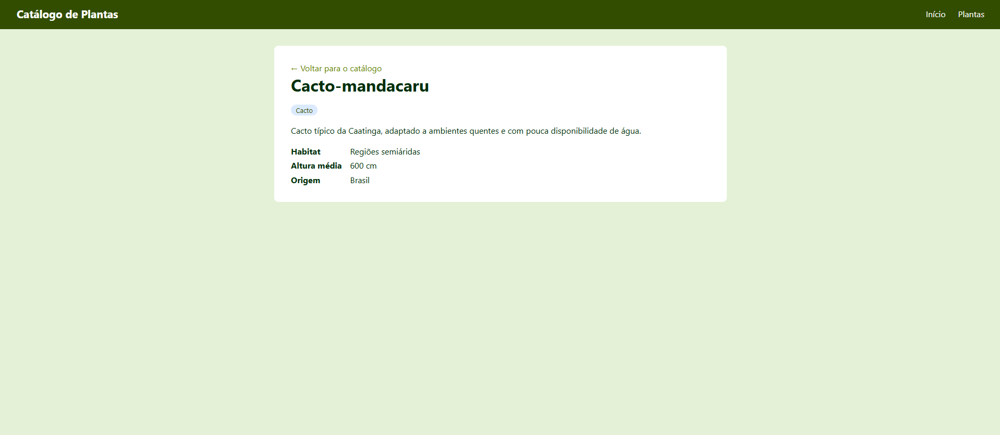
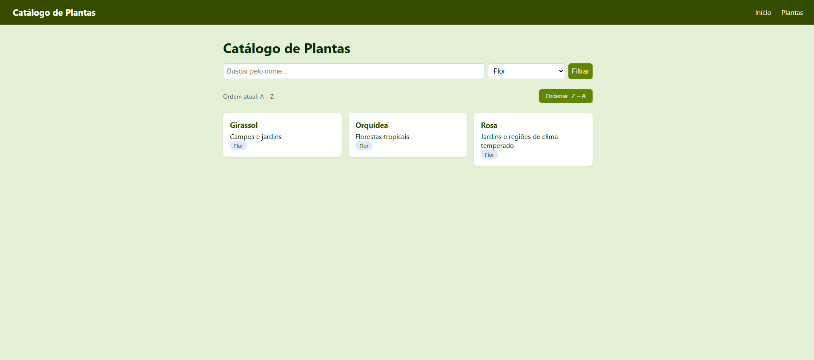
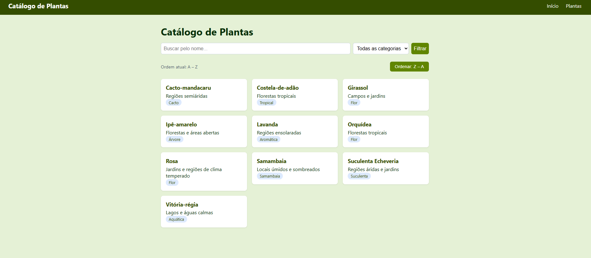
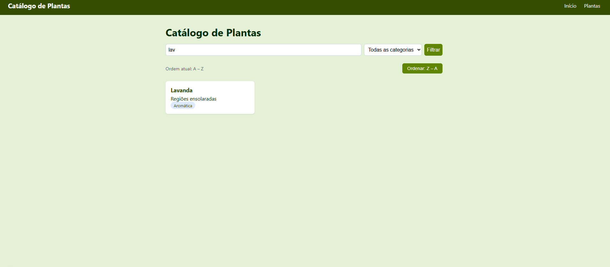

O Catálogo de Plantas é um site desenvolvido para mostrar diferentes espécies de plantas e suas características. O site apresenta informações como nome, categoria, habitat, altura média, origem e descrição de cada planta.

Comandos para rodar o projeto

1. npm install

2. npm run seed

3. npm run dev

4. No navegador:
   "http://localhost:3000"

   Print das páginas.

   Imagem da aba de detalhes da planta selecionada:
   

   Imagem do filtro de categoria da planta:
   

   Imagem da lista geral das plantas:
   

   Imagem da do filtro de pesquisa por digitação: 
   

Melhoria: Ordenação alfabética

Foi adicionado ao catálogo um botão com a funcionalidade de ordenação alfabética das plantas para organizar elas em ordem crescente (A – Z) ou decrescente (Z – A).

Alterações feitas: 

lib/db.js: a função "listarPlantas()" foi alterada pra ter o parâmetro de ordenação e organizar os nomes das plantas em ordem crescente ou decrescente. 

app/plantas/page.js: mais um botão pra alternar entre as duas formas de ordenação.

app/globals.css: estilo pro botão 
