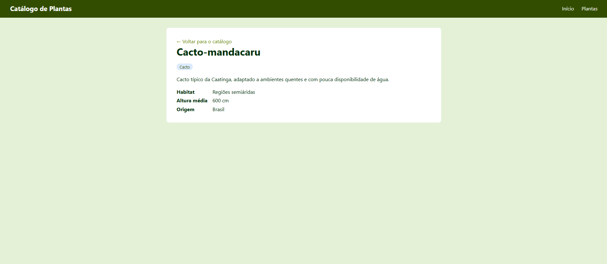

O Catálogo de Plantas é um site desenvolvido para mostrar diferentes espécies de plantas e suas características. O site apresenta informações como nome, categoria, habitat, altura média, origem e descrição de cada planta.

Comandos para rodar o projeto

1.  npm install

2. npm run seed

3. npm run dev

4. No navegador:
   "http://localhost:3000"

   Print das páginas:
   